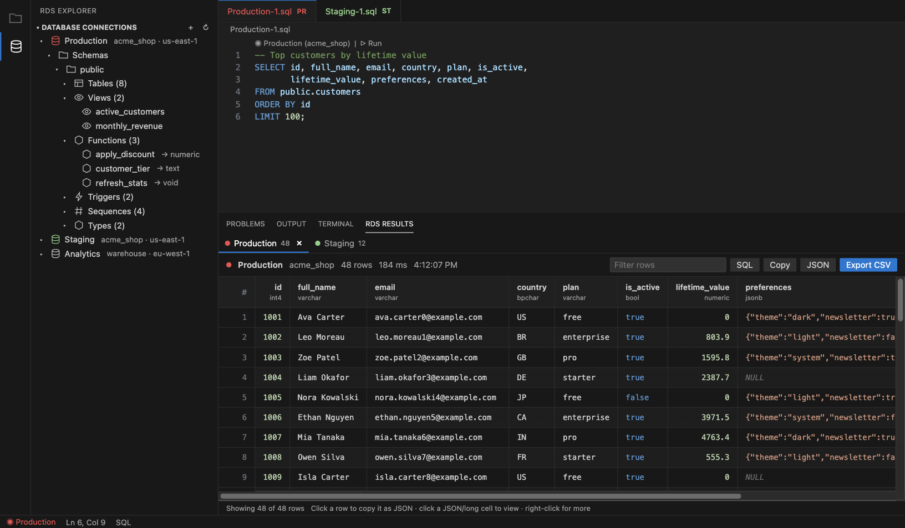
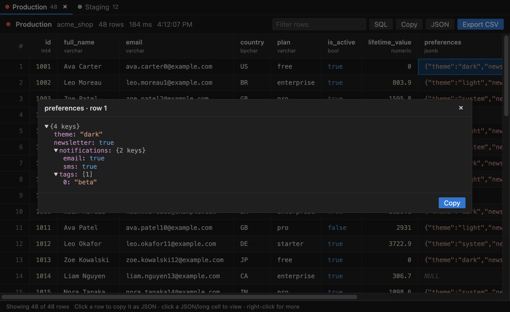
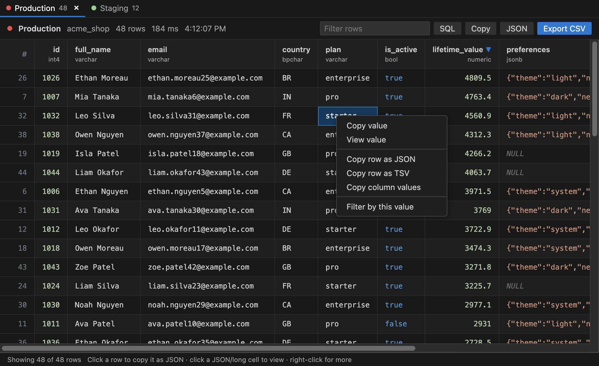
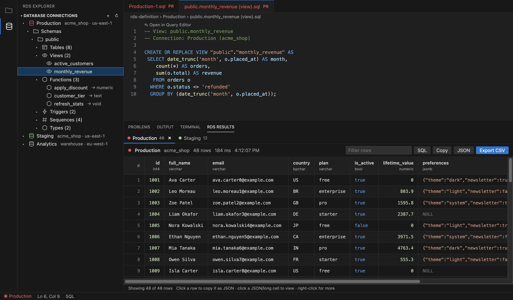

# RDS Explorer

Browse and query **AWS Aurora / RDS PostgreSQL** databases from VS Code using the [RDS Data API](https://docs.aws.amazon.com/AmazonRDS/latest/AuroraUserGuide/data-api.html), with no VPN, bastion host or open database port. If your AWS credentials can call the Data API, you can explore the database.



## Features

- **Database explorer**: schemas, tables, columns, indexes, views, functions, procedures, triggers, sequences and types.
- **SQL editors bound to a connection**: each editor is named after its connection and shows which database it runs against, so it's clear which file goes with which database.
- **Results panel next to the terminal**: a sortable, filterable grid with one tab per connection.
- **JSON-aware**: JSON/JSONB values open as a collapsible tree.
- **Copy and export**: copy rows as JSON or TSV, copy columns, export to CSV or JSON.
- **Read-only definitions**: view the `CREATE` statement for any view, function, trigger, sequence or type with full SQL highlighting.
- **Connection colours**: mark production red (or any colour) on the tree, tabs, status bar and results.
- **Query history**: re-run recent queries on the connection they ran against.

## Requirements

- An Aurora (PostgreSQL) cluster with the **Data API enabled**
- A **Secrets Manager** secret holding the database credentials
- AWS credentials available locally (`~/.aws/credentials`, SSO, environment variables, etc.) with permission to call `rds-data:ExecuteStatement` and `secretsmanager:GetSecretValue`
- VS Code 1.75 or newer

## Getting started

1. Open the **RDS Explorer** view in the Activity Bar.
2. Click **+** (Open Connection) and enter:
   | Field | Example |
   | --- | --- |
   | Name | `Production` |
   | DB cluster ARN | `arn:aws:rds:us-east-1:123456789012:cluster:my-cluster` |
   | Secret ARN | `arn:aws:secretsmanager:us-east-1:123456789012:secret:my-secret` |
   | Database | `postgres` |
   | Region | `us-east-1` |
   | AWS profile | `default` |
3. Expand the connection to browse, or click the **New Query** icon beside it to start writing SQL.

Right-click a connection to **Edit**, **Delete**, or **Set Connection Color**.

## Writing queries

- Press **Cmd+Enter** (macOS) or **Ctrl+Enter** (Windows/Linux) to run the selection, or the whole editor if nothing is selected.
- New editors are named after their connection (`Production-1.sql`) and show a connection badge on the tab.
- A line at the top of the editor shows the connection: click it to switch databases, or click **Run**.
- The status bar shows the active editor's connection in its colour.
- Right-click a table and choose **Select Top 10 Rows** for a quick preview.

## Results panel

Results open in the **RDS Results** tab of the bottom panel, with one tab per connection, so results from two databases can sit side by side.

- **Sort**: click a column header (ascending, then descending, then off).
- **Filter**: type in **Filter rows** to search every column.
- **Copy a row**: click it to copy it as JSON.
- **View full values**: click a JSON or long cell to open it; JSON is shown as a tree.
- **Right-click a cell**: copy the value, row (JSON/TSV) or column, or filter by the value.
- **Copy / Export**: **Copy** puts the visible rows on the clipboard as TSV, ready to paste into Excel or Sheets. **Export CSV** and **JSON** save to a file.
- **Keyboard**: use the arrow keys to move between cells, **Enter** to open a value, and **Cmd/Ctrl+C** to copy the selected cell.





## Object definitions

Click a view, function, procedure, trigger, sequence or type in the explorer to open its definition in a read-only SQL editor. Use **Open in Query Editor** at the top of the definition to edit and run a copy against the same connection.



## Security

- Credentials are never stored by the extension. Each query uses your AWS profile and the Secrets Manager secret you configure.
- Saved connections store only names, ARNs, region and profile.
- Query results are displayed locally and are not sent anywhere else.

## Development

```bash
npm install
npm run watch     # then press F5 to launch the Extension Development Host
npm run lint
npm run build     # produces a .vsix
```

## Author

vamshi krishna